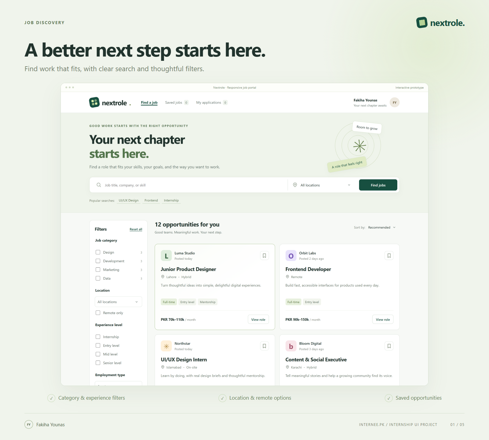
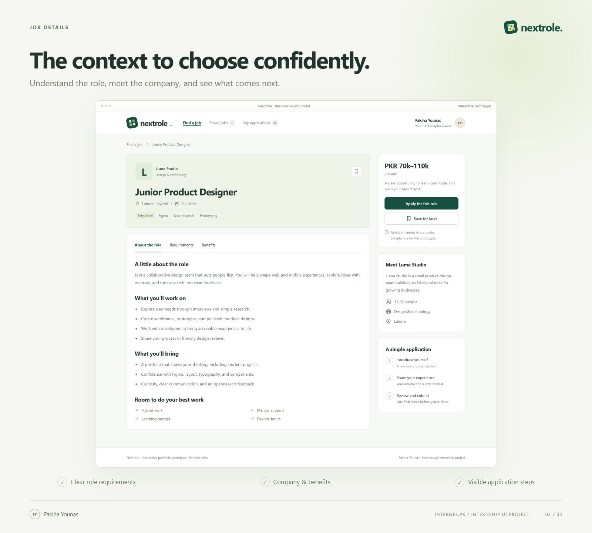
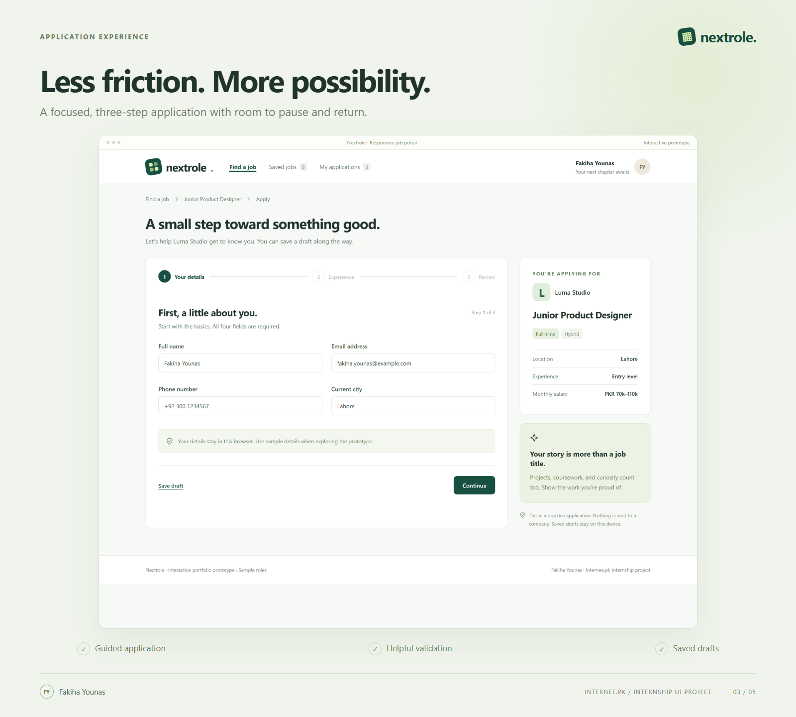
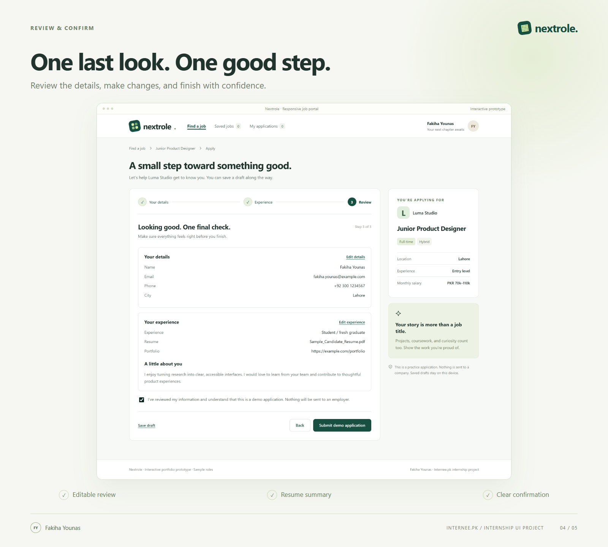
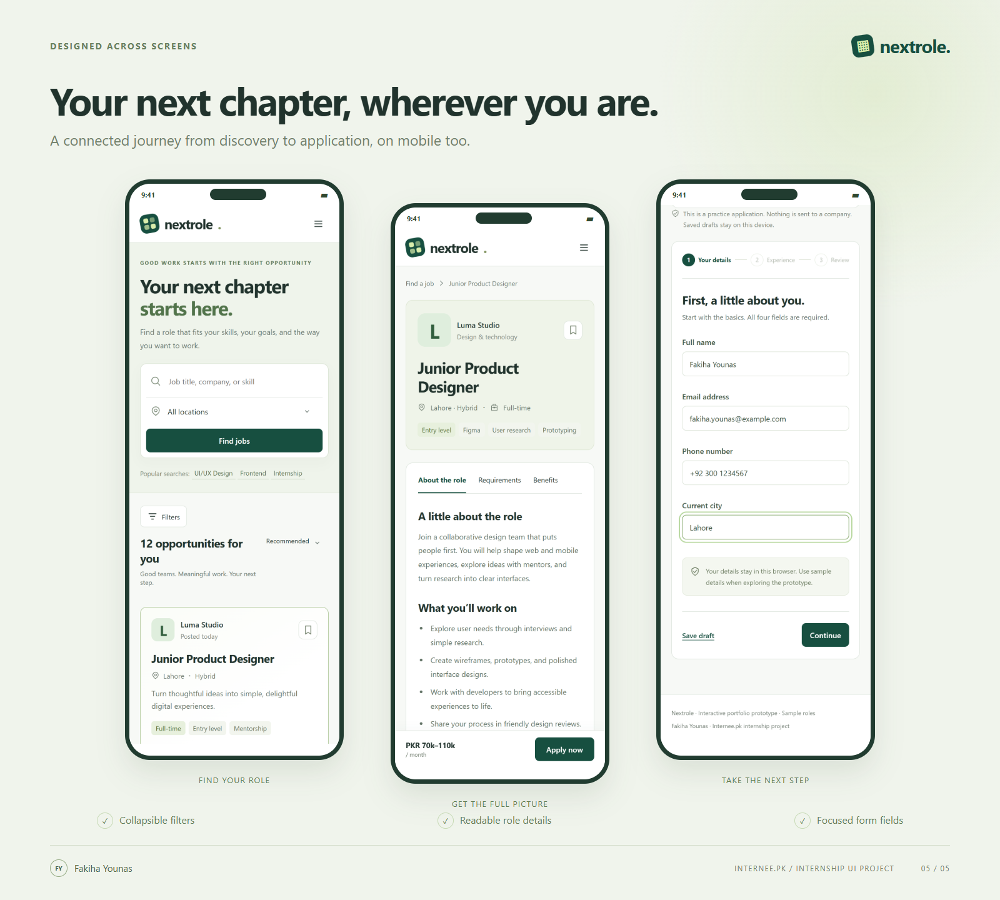

# Nextrole — Responsive Job Portal UI

A responsive job portal prototype that makes the journey from discovery to application clear and approachable. Designed by **Fakiha Younas** as an **Internee.pk internship project**.



## Open the prototype

Choose **Code → Download ZIP**, extract the files, and open **`index.html`** in Chrome or Edge. No installation or server is needed. Open **`handoff.html`** for the project guide and Figma setup.

Try this journey: search for a role → combine category, location, and experience filters → open **Junior Product Designer** → apply → enter sample details → select a resume or use the sample → review → submit the demo application.

## Pages and interactions

| Page | Included interactions |
| --- | --- |
| Job listings | Search by title, company, or skill; category, location, experience, employment-type, and remote filters; sort; pagination; clearable filter chips; empty states. |
| Job details | Role description, responsibilities, requirements, skills, company information, benefits, application steps, and mobile apply button. |
| Application form | Three steps: personal details, experience and resume, final review. Required-field validation, file type and size checks, sample resume, editable review, draft saving, and confirmation. |
| Saved jobs | Bookmark roles, return to the shortlist, and remove saved jobs. |
| My applications | Continue or delete drafts and review local demo confirmations. |

Desktop, tablet, and mobile layouts are included. Browser checks cover widths of **1440, 1024, 768, 390, and 360 px**, with no page-level horizontal overflow in the tested routes.

## LinkedIn screenshots

Five branded PNG images, each **1600 × 1440 px**, are in **[docs/linkedin](docs/linkedin)**. Upload them in numerical order. The ready-to-copy caption is in **[LINKEDIN_POST.txt](LINKEDIN_POST.txt)**.

Nine original desktop and mobile captures at 2× resolution are in **[docs/screenshots](docs/screenshots)**. Open `docs/showcase.html` locally to view the complete presentation.

| Role details | Application form |
| --- | --- |
|  |  |

| Application review | Responsive mobile experience |
| --- | --- |
|  |  |

## Editable Figma design

The generator creates **21 editable screens: 13 desktop and 8 mobile**, with Auto Layout, vertical prototype scrolling, two named flows, and five component sets:

- **Button:** primary/secondary × default/hover/disabled.
- **Input:** default/focus/error/filled.
- **Checkbox:** off/on, with click interactions.
- **Bookmark:** off/on, with click interactions.
- **Step indicator:** upcoming/current/done.

Button hover and component state changes use native variant interactions. Screen navigation uses 250 ms Smart Animate. The implementation follows Figma’s [prototype reaction API](https://developers.figma.com/docs/plugins/api/properties/nodes-reactions/) and [trigger API](https://developers.figma.com/docs/plugins/api/Trigger/).

To generate the design:

1. Extract [Nextrole_Figma_Generator.zip](Nextrole_Figma_Generator.zip), or use `figma-plugin/` from this repository.
2. Open a Design file in the Figma desktop app.
3. Choose **Plugins → Development → Import plugin from manifest** and select `figma-plugin/manifest.json`.
4. Run **Nextrole — Responsive Job Portal**.
5. Open Present and choose the desktop or mobile search-to-application flow.

The generator passes TypeScript compilation and structural mock checks, but **has not been executed inside native Figma**. A Figma account file is not included. Figma uses prepared example states centered on the Junior Product Designer role; the browser prototype implements real filtering, typing, file selection, drafts, and local application records. See [figma-plugin/README.txt](figma-plugin/README.txt) for the screen map and limits.

## Prototype scope

All companies, openings, salaries, and posting dates are sample content. This is a UI portfolio project, not a live recruitment service.

Saved jobs, explicitly saved drafts, and demo confirmations use browser local storage. Unsaved form entries remain in the current page session. Resume files stay in memory and are never uploaded; after reloading a saved draft, a real file must be selected again. A clearly labeled sample resume allows trying the journey without supplying a personal file.

Submitting creates a local **Demo submitted** record. No employer receives the application, and no email or external request is sent. Confirmation prevents duplicate demo submissions for the same role.

## Development and checks

Built with HTML, CSS, and vanilla JavaScript. The Figma generator is written in TypeScript.

```sh
npm ci
npm test
npm run figma:build
npm run test:figma
npm run screenshots
python package-project.py
```

The browser scripts default to Windows Chrome at `C:/Program Files/Google/Chrome/Application/chrome.exe`; set `CHROME_PATH` to use another Chromium executable. Python 3 packages the complete project, the Figma generator, and the LinkedIn images into separate ZIP files.

Validation reports: [browser-validation.json](browser-validation.json) and [figma-validation.json](figma-validation.json). Figma structural checks include screen counts, variants, connection targets, scroll configuration, and approximate horizontal sizing; they do not replace native Figma testing.

**Fakiha Younas** · Internee.pk internship project

Repository: [mrjerry675/nextrole-job-portal-ui](https://github.com/mrjerry675/nextrole-job-portal-ui)
